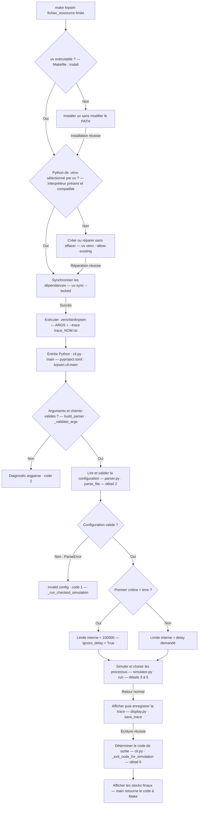
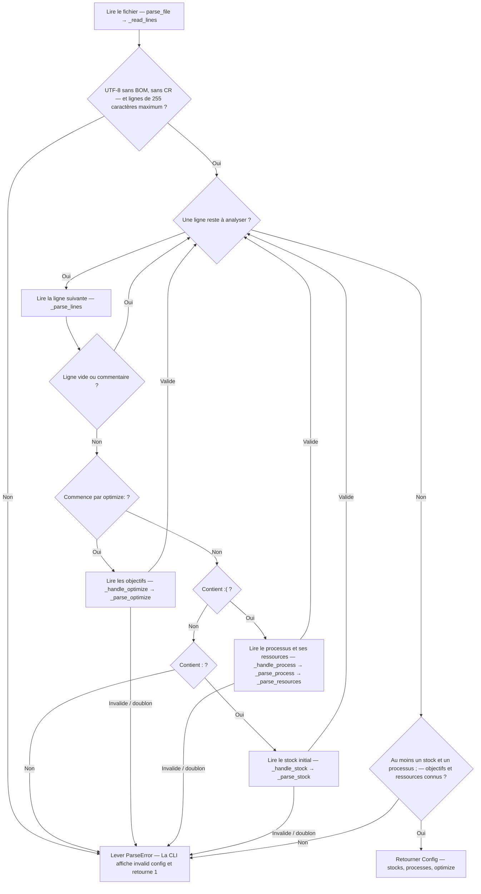
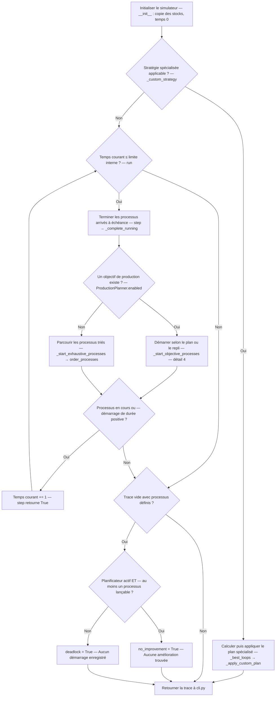
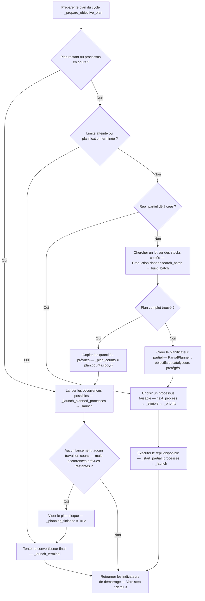
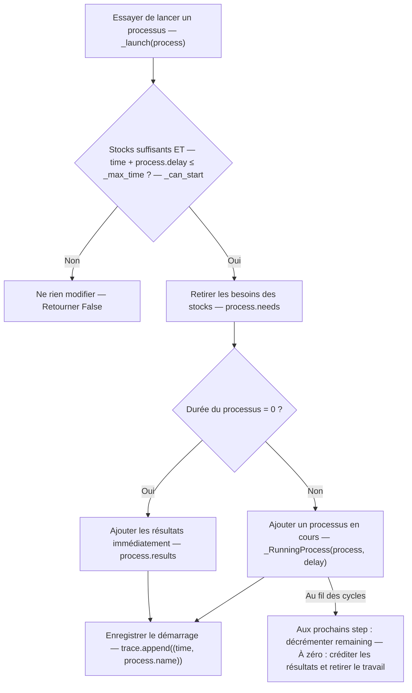
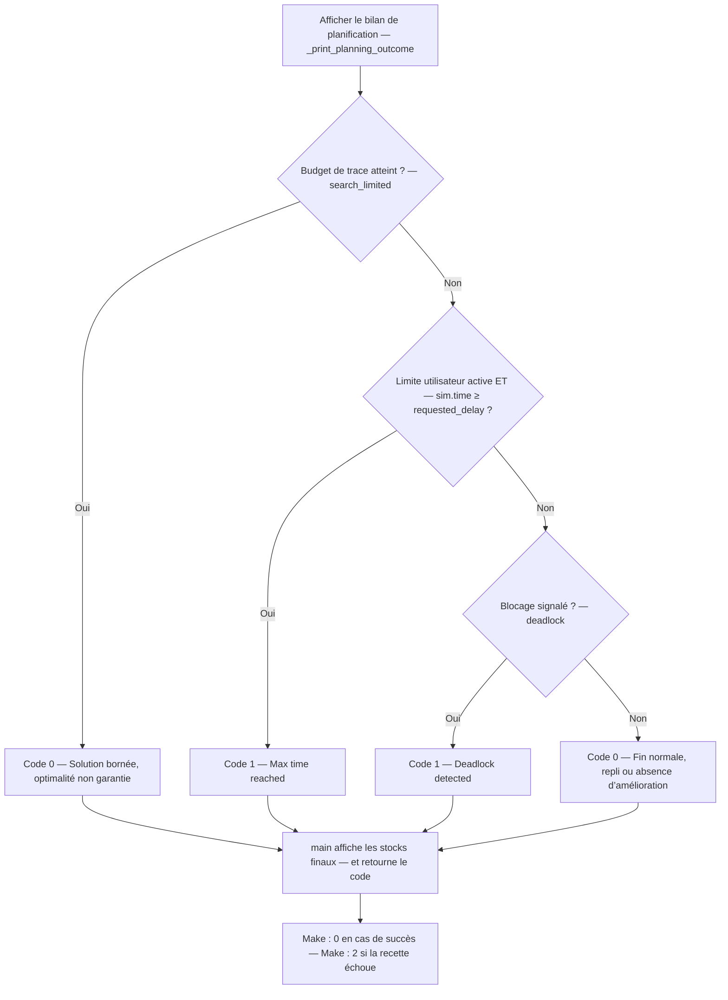

# Comprendre `make krpsim` — parcours de décision en français

Guide pour **Paul et Sylvanna**, établi à partir du code présent dans le dépôt le 3 novembre 2026.

Les noms français sont des **traductions pédagogiques**, pas des renommages du code. Chaque graphe garde les identifiants réels pour permettre une recherche dans l'éditeur. Les losanges sont des décisions ; les rectangles sont des actions. Les sorties rouges demandent de lire leur libellé : un refus interne de démarrage n'est pas nécessairement un échec de la commande.

Dans la demande « `make krpsim *` », `*` désigne ici les arguments à fournir. Ne pas taper littéralement `*` : le shell le développerait en noms de fichiers.

```bash
make krpsim resources/good_resources/ikea 10
```

Après installation, Make lance l'équivalent de :

```bash
.venv/bin/krpsim resources/good_resources/ikea 10 --trace trace_ikea.txt
```

Les ressources de ce dépôt sont sous `resources/good_resources/` et `resources/bad_resources/`. Le chemin `resources/ikea` cité dans d'anciens exemples n'existe pas dans l'état étudié.

## Carte des fichiers

| Fichier réel | Nom / rôle en français | Entrée ou résultat utile |
| --- | --- | --- |
| [Makefile](../Makefile) | Préparer l'environnement et lancer la commande | `install`, `ARGS`, `.venv/bin/krpsim`, `--trace` |
| [pyproject.toml](../pyproject.toml#L38) | Déclarer l'exécutable Python | `krpsim = "krpsim.cli:main"` |
| [.python-version](../.python-version), [uv.lock](../uv.lock) | Fixer Python et les dépendances | Python 3.13 ; synchronisation verrouillée |
| [cli.py](../src/krpsim/cli.py) | Interface de commande | Arguments → configuration → simulation → sortie |
| [parser.py](../src/krpsim/parser.py) | Analyseur de configuration | Fichier → `Config` et `Process` |
| [simulator.py](../src/krpsim/simulator.py) | Moteur de simulation | Stocks réels, temps, travaux en cours, trace |
| [optimizer.py](../src/krpsim/optimizer.py) | Planificateur et ordre des processus | Stocks copiés → candidats → lot |
| [partial.py](../src/krpsim/partial.py) | Planificateur de production intermédiaire | Repli lorsqu'aucun plan complet n'est trouvé |
| [display.py](../src/krpsim/display.py) | Présentation et écriture | En-tête, trace durable sur disque |
| [__init__.py](../src/krpsim/__init__.py) | Surface publique du paquet | `version()` existe mais n'est pas appelée par ce parcours |

L'optimiseur est **appelé par le simulateur** ; il n'est pas un passage unique entre le parseur et le simulateur. `krpsim_verif` est une commande distincte, à lancer après la génération de la trace ; `make krpsim` ne l'appelle pas automatiquement.

## Mode de lecture

Lire le graphe 1 pour comprendre l'ensemble, puis les détails 2 à 6. Les fichiers SVG permettent de zoomer ; les fichiers DOT sont leurs sources modifiables. Les graphes Mermaid sont lisibles dans un aperçu Markdown compatible.


## 1. De make krpsim à la trace

[Ouvrir le graphe SVG](diagrammes-krpsim-fr/01-parcours.svg) · [Source DOT](diagrammes-krpsim-fr/01-parcours.dot)



Un échec d'installation arrête Make avant Python. Les deux arguments sont transmis à Python ; Make ne les valide pas. Le nom de trace enlève le répertoire et la dernière extension du fichier source. La trace est écrite dans le répertoire de travail du projet.

Le graphe montre les erreurs prises en charge explicitement. `save_trace` peut lever une `OSError` non interceptée par la CLI : un retour propre n'est donc pas garanti pour toute panne d'écriture. La trace est enregistrée **avant** le calcul du code de sortie métier ; elle peut exister même si le programme retourne `1`.


## 2. parser.py : construire une configuration

[Ouvrir le graphe SVG](diagrammes-krpsim-fr/02-lecture.svg) · [Source DOT](diagrammes-krpsim-fr/02-lecture.dot)



`parse_file` contrôle aussi le chemin : pas de composant `..`, fichier existant et lisible. `_validate_optimize` accepte le mot réservé `time` et les ressources connues. `_validate_process_resources` vérifie que chaque besoin est déclaré en stock ou produit par un processus ; cela ne prouve pas qu'il sera effectivement disponible pendant l'exécution.

Stock initial : quantité entière **≥ 0**. Besoin ou résultat de processus : quantité entière **> 0**. Durée d'un processus : entier **≥ 0**. La limite passée à la CLI doit, elle, être **> 0**. `optimize` est facultatif ; ses critères restent ordonnés.


## 3. simulator.py : choisir la voie et avancer

[Ouvrir le graphe SVG](diagrammes-krpsim-fr/03-simulation.svg) · [Source DOT](diagrammes-krpsim-fr/03-simulation.dot)



La stratégie spécialisée exige une seule cible hors `time`, un producteur unique de cette cible, une ressource restituée par ce producteur, une autre ressource consommée, puis un processus capable d'augmenter cette dernière en restituant la première. Elle applique un plan séquentiel et contourne la boucle `step`.

Dans la voie générale, chaque appel à `step` termine d'abord les travaux précédents, puis tente des démarrages. L'exécution dite « exhaustive » répète des passages sur les processus triés jusqu'à l'absence de nouveau démarrage ou la répétition d'un état de stocks. Ce n'est pas une recherche exhaustive de tous les ordonnancements.

`deadlock` n'est posé en fin de boucle que lorsque **la trace est vide** et qu'il existe des processus ; il ne représente pas tous les arrêts possibles après une production.


## 4. optimizer.py et partial.py : préparer les démarrages

[Ouvrir le graphe SVG](diagrammes-krpsim-fr/04-planification.svg) · [Source DOT](diagrammes-krpsim-fr/04-planification.dot)



`build_batch` essaie les producteurs du but. `_plan_process` et `_ensure` construisent les dépendances sur des **copies** de stocks : ils ne démarrent aucun processus réel. `_build_candidate` conserve un gain positif sur le premier objectif. `_select_candidate` choisit la meilleure qualité et départage par nom.

En mode `time` prioritaire, la qualité tient compte d'une anticipation bornée (`_completion_quality`, profondeur 3 et budget 256). Les autres modes comparent le gain, le coût en matières puis la durée. Le gain est un tuple comparé dans l'ordre des objectifs. `_extend_finite_batch` et `_extend_parallel_self_production` peuvent augmenter le lot retenu. La limite d'expansion est 100000.

Sans plan, `search_batch` distingue `not_found` et `budget_exhausted` ; le simulateur essaie ensuite le repli. `PartialPlanner` remonte les dépendances des objectifs, protège les objectifs et les ressources restituées, refuse les états déjà visités et privilégie les conversions disponibles, puis les durées courtes et le nom.

Le repli répète les démarrages immédiats et rend la main après un démarrage de durée positive ; s'il ne trouve plus de candidat ou atteint le budget de trace, il tente le convertisseur final. Celui-ci n'existe que pour certaines configurations à une cible, avec conversion finale immédiate d'une unique ressource. Il n'est pas une étape obligatoire.

Ces recherches sont heuristiques et bornées : « pas de plan trouvé » ne prouve pas l'impossibilité, et un succès ne prouve pas l'optimalité globale.


## 5. simulator.py : exécuter un processus

[Ouvrir le graphe SVG](diagrammes-krpsim-fr/05-lancement.svg) · [Source DOT](diagrammes-krpsim-fr/05-lancement.dot)



La trace décrit les **démarrages**, pas les fins. Plusieurs lignes peuvent porter le même cycle. Les entrées sont consommées au démarrage ; les sorties apparaissent à l'échéance, ou immédiatement pour une durée nulle. Le refus de `_launch` est un résultat interne normal, pas nécessairement une erreur de la commande.


## 6. cli.py : décider du code de sortie métier

[Ouvrir le graphe SVG](diagrammes-krpsim-fr/06-sortie.svg) · [Source DOT](diagrammes-krpsim-fr/06-sortie.dot)



L'ordre des décisions est celui du code : `search_limited` est prioritaire sur le dépassement de délai et le blocage. `ignore_delay` désactive le test de la limite utilisateur lorsque `time` est le premier critère. Le budget d'exploration (`planning_status == "budget_exhausted"`) est distinct du budget de trace (`search_limited`) ; le premier n'impose pas à lui seul un code d'échec.

Ce graphe intervient après l'écriture de la trace. Les erreurs d'arguments (`2`) et de configuration (`1`) sortent plus tôt et ne passent pas par ce bilan. Make conserve le diagnostic et constate l'échec de la recette, mais son propre code de sortie n'est pas nécessairement celui de Python.


## Exemple suivi : IKEA, limite demandée de 10

Exécution vérifiée avec l'exécutable actuel :

1. Make construit `trace_ikea.txt` et transmet `10` comme `args.delay`.
2. `parse_file` lit 7 planches, 4 processus et `optimize:(time;armoire)`.
3. `time` étant premier, `ignore_delay = True` et `run_delay = 100000`.
4. La stratégie spécialisée ne s'applique pas ; le planificateur construit les composants nécessaires à une armoire.
5. Au cycle 0, les démarrages consomment les 7 planches : 2 montants, 1 fond et 3 étagères sont lancés.
6. Les étagères terminent à 10, les montants à 15 et le fond à 20. À 20, l'armoire peut démarrer.
7. À 50, l'armoire est produite. La trace compte 7 démarrages, le stock final contient 1 armoire et le code Python est `0`.

```text
0:do_montant
0:do_montant
0:do_fond
0:do_etagere
0:do_etagere
0:do_etagere
20:do_armoire_ikea
```

`50` est le temps final, mais ne figure pas dans cette trace : celle-ci contient uniquement les démarrages. La limite demandée `10` n'est pas la durée de chacun des processus et, dans ce mode précis, n'arrête pas la simulation à 10.

## Modèles de données en français

| Nom réel | Traduction pédagogique | Contenu |
| --- | --- | --- |
| `Config` | `Configuration` | `stocks` initiaux ; `processes` par nom ; `optimize` ordonné et facultatif |
| `Process` | `Processus` | `name` : nom ; `needs` : besoins ; `results` : production ; `delay` : durée |
| `_RunningProcess` | `ProcessusEnCours` | Définition du processus et `remaining`, durée restante |
| `Simulator` | `Simulateur` | Stocks évolutifs, temps, trace et indicateurs d'arrêt |
| `ProductionPlanner` | `PlanificateurProduction` | But, producteurs, recherche de lots et convertisseur final éventuel |
| `BatchPlan` | `PlanDeLot` | `counts` : occurrences ; `expected_gain` : gains attendus ; `limited` : plan borné |
| `PlanningResult` | `ResultatPlanification` | `plan` éventuel ; `status` : `complete`, `budget_exhausted` ou `not_found` |
| `_BatchCandidate` | `CandidatDeLot` | Qualité, processus, stocks virtuels et occurrences prévues |
| `PartialPlanner` | `PlanificateurPartiel` | Dépendances, ressources protégées et états déjà visités |
| `ParseError` | `ErreurConfiguration` | Erreur de lecture ou de cohérence prise en charge par la CLI |

Les fonctions ci-dessous utilisent des noms français proposés pour la lecture. Les signatures omettent les annotations de type et les valeurs par défaut ; elles ne sont pas destinées à être copiées comme du code exécutable.

## Dictionnaire des fonctions et de leurs paramètres


### `cli.py`

| Fonction réelle | Lecture française de la signature |
| --- | --- |
| [`build_parser`](../src/krpsim/cli.py#L33) | `construire_analyseur_arguments()` |
| [`_validate_args`](../src/krpsim/cli.py#L84) | `valider_arguments(arguments_analyses, analyseur_arguments)` |
| [`_run_simulation`](../src/krpsim/cli.py#L132) | `executer_simulation(arguments_analyses)` |
| [`_run_checked_simulation`](../src/krpsim/cli.py#L171) | `executer_simulation_avec_gestion_erreur_configuration(arguments_analyses)` |
| [`_print_planning_outcome`](../src/krpsim/cli.py#L180) | `afficher_bilan_planification(simulateur)` |
| [`_exit_code_for_simulation`](../src/krpsim/cli.py#L193) | `determiner_code_sortie(simulateur, limite_demandee, ignorer_limite_utilisateur)` |
| [`main`](../src/krpsim/cli.py#L219) | `point_entree(arguments_bruts)` |


### `parser.py`

| Fonction réelle | Lecture française de la signature |
| --- | --- |
| [`Config.all_stock_names`](../src/krpsim/parser.py#L75) | `recenser_noms_ressources()` |
| [`_parse_stock`](../src/krpsim/parser.py#L109) | `analyser_stock(ligne)` |
| [`_parse_resources`](../src/krpsim/parser.py#L149) | `analyser_bloc_ressources(bloc_ressources)` |
| [`_parse_process`](../src/krpsim/parser.py#L201) | `analyser_processus(ligne)` |
| [`_parse_optimize`](../src/krpsim/parser.py#L249) | `analyser_objectifs(ligne)` |
| [`_handle_optimize`](../src/krpsim/parser.py#L298) | `enregistrer_objectifs(ligne, criteres_optimisation)` |
| [`_handle_process`](../src/krpsim/parser.py#L324) | `enregistrer_processus(ligne, processus_par_nom)` |
| [`_handle_stock`](../src/krpsim/parser.py#L352) | `enregistrer_stock(ligne, stocks)` |
| [`_validate_optimize`](../src/krpsim/parser.py#L380) | `valider_objectifs(criteres_optimisation, stocks, processus_par_nom)` |
| [`_validate_process_resources`](../src/krpsim/parser.py#L422) | `valider_references_ressources(stocks, processus_par_nom)` |
| [`_read_lines`](../src/krpsim/parser.py#L467) | `lire_lignes(chemin)` |
| [`_parse_lines`](../src/krpsim/parser.py#L517) | `analyser_lignes(lignes)` |
| [`parse_file`](../src/krpsim/parser.py#L574) | `lire_configuration(chemin)` |


### `simulator.py`

| Fonction réelle | Lecture française de la signature |
| --- | --- |
| [`Simulator.__init__`](../src/krpsim/simulator.py#L57) | `initialiser_simulateur(configuration)` |
| [`Simulator._complete_running`](../src/krpsim/simulator.py#L102) | `terminer_processus_echus()` |
| [`Simulator._start_processes`](../src/krpsim/simulator.py#L138) | `choisir_mode_demarrage()` |
| [`Simulator._can_start`](../src/krpsim/simulator.py#L159) | `peut_demarrer(processus)` |
| [`Simulator._launch`](../src/krpsim/simulator.py#L167) | `demarrer_processus(processus)` |
| [`Simulator._launch_terminal`](../src/krpsim/simulator.py#L182) | `demarrer_conversion_finale()` |
| [`Simulator._start_objective_processes`](../src/krpsim/simulator.py#L193) | `demarrer_selon_objectifs()` |
| [`Simulator._prepare_objective_plan`](../src/krpsim/simulator.py#L207) | `preparer_plan_objectif()` |
| [`Simulator._start_partial_processes`](../src/krpsim/simulator.py#L235) | `demarrer_production_partielle(planificateur)` |
| [`Simulator._launch_planned_processes`](../src/krpsim/simulator.py#L253) | `demarrer_processus_planifies()` |
| [`Simulator._plan_is_stalled`](../src/krpsim/simulator.py#L268) | `plan_est_bloque(au_moins_un_demarrage)` |
| [`Simulator._start_exhaustive_processes`](../src/krpsim/simulator.py#L273) | `demarrer_processus_disponibles()` |
| [`Simulator.step`](../src/krpsim/simulator.py#L296) | `executer_un_cycle()` |
| [`Simulator.run`](../src/krpsim/simulator.py#L326) | `executer_simulation(limite_simulation)` |
| [`Simulator._custom_strategy`](../src/krpsim/simulator.py#L367) | `essayer_strategie_specialisee(limite_simulation)` |
| [`Simulator._single_target`](../src/krpsim/simulator.py#L415) | `trouver_cible_unique()` |
| [`Simulator._target_process`](../src/krpsim/simulator.py#L437) | `trouver_producteur_unique(cible)` |
| [`Simulator._split_resources`](../src/krpsim/simulator.py#L459) | `identifier_ressource_restituee_et_ressource_principale(processus)` |
| [`Simulator._find_booster`](../src/krpsim/simulator.py#L490) | `trouver_producteur_renforcant(ressource_restituee, ressource_principale, processus_cible)` |
| [`Simulator._best_loops`](../src/krpsim/simulator.py#L536) | `choisir_nombre_repetitions(processus_renforcant, processus_cible, ressource_principale, limite_simulation)` |
| [`Simulator._apply_custom_plan`](../src/krpsim/simulator.py#L600) | `appliquer_plan_specialise(processus_renforcant, processus_cible, repetitions_renforcement, cibles, limite_simulation)` |


### `optimizer.py`

| Fonction réelle | Lecture française de la signature |
| --- | --- |
| [`ProductionPlanner.__init__`](../src/krpsim/optimizer.py#L59) | `initialiser_planificateur_production(configuration)` |
| [`ProductionPlanner.enabled`](../src/krpsim/optimizer.py#L76) | `planification_active()` |
| [`ProductionPlanner._terminal_converter`](../src/krpsim/optimizer.py#L81) | `detecter_convertisseur_final()` |
| [`ProductionPlanner.terminal_count`](../src/krpsim/optimizer.py#L100) | `compter_conversions_finales_possibles(stocks)` |
| [`ProductionPlanner.search_batch`](../src/krpsim/optimizer.py#L110) | `chercher_lot_avec_statut(stocks, duree_maximale, budget_demarrages_paralleles)` |
| [`ProductionPlanner.build_batch`](../src/krpsim/optimizer.py#L126) | `construire_lot(stocks, duree_maximale, budget_demarrages_paralleles)` |
| [`ProductionPlanner._extend_parallel_self_production`](../src/krpsim/optimizer.py#L168) | `etendre_autoproduction_parallele(candidat, stocks, nombre_maximal_demarrages)` |
| [`ProductionPlanner._completion_quality`](../src/krpsim/optimizer.py#L201) | `evaluer_qualite_avec_anticipation(stocks_initiaux, stocks_virtuels, occurrences_par_processus, profondeur_recherche, budget_recherche, duree_maximale)` |
| [`ProductionPlanner._build_candidate`](../src/krpsim/optimizer.py#L247) | `construire_candidat(processus, stocks)` |
| [`ProductionPlanner._material_cost`](../src/krpsim/optimizer.py#L266) | `calculer_cout_matieres(occurrences_par_processus)` |
| [`ProductionPlanner._batch_duration`](../src/krpsim/optimizer.py#L276) | `estimer_duree_cumulee(occurrences_par_processus)` |
| [`ProductionPlanner._candidate_quality`](../src/krpsim/optimizer.py#L283) | `evaluer_qualite_candidat(gains_objectifs, cout_matieres, duree_estimee)` |
| [`ProductionPlanner._select_candidate`](../src/krpsim/optimizer.py#L295) | `choisir_meilleur_candidat(candidats)` |
| [`ProductionPlanner._extend_finite_batch`](../src/krpsim/optimizer.py#L313) | `etendre_lot_a_stock_limite(processus, stocks_initiaux, stocks_virtuels, occurrences_par_processus)` |
| [`ProductionPlanner._gain`](../src/krpsim/optimizer.py#L346) | `calculer_gains_objectifs(stocks_avant, stocks_apres)` |
| [`ProductionPlanner._ranked_producers`](../src/krpsim/optimizer.py#L356) | `classer_producteurs(ressource)` |
| [`ProductionPlanner._ensure`](../src/krpsim/optimizer.py#L370) | `assurer_quantite_virtuelle(ressource, quantite, stocks_virtuels, occurrences_par_processus, ressources_en_cours_exploration, compteur_expansions)` |
| [`ProductionPlanner._plan_process`](../src/krpsim/optimizer.py#L411) | `planifier_processus_et_dependances(processus, stocks_virtuels, occurrences_par_processus, ressources_en_cours_exploration, compteur_expansions)` |
| [`_target_requirements`](../src/krpsim/optimizer.py#L442) | `recenser_besoins_des_cibles(configuration)` |
| [`_sort_key_factory`](../src/krpsim/optimizer.py#L458) | `construire_cle_de_tri(configuration, besoins_des_cibles)` |
| [`_sort_key_factory.sort_key`](../src/krpsim/optimizer.py#L464) | `calculer_cle_de_tri(processus)` |
| [`order_processes`](../src/krpsim/optimizer.py#L488) | `ordonner_processus(configuration)` |


### `partial.py`

| Fonction réelle | Lecture française de la signature |
| --- | --- |
| [`PartialPlanner.__init__`](../src/krpsim/partial.py#L15) | `initialiser_planificateur_partiel(configuration, cibles)` |
| [`PartialPlanner._dependencies`](../src/krpsim/partial.py#L26) | `remonter_dependances(configuration, cibles)` |
| [`PartialPlanner._eligible`](../src/krpsim/partial.py#L41) | `est_admissible(processus, stocks, duree_restante)` |
| [`PartialPlanner._priority`](../src/krpsim/partial.py#L54) | `calculer_priorite(processus)` |
| [`PartialPlanner.next_process`](../src/krpsim/partial.py#L61) | `choisir_prochain_processus(stocks, duree_restante)` |


### `display.py`

| Fonction réelle | Lecture française de la signature |
| --- | --- |
| [`_pluralize`](../src/krpsim/display.py#L27) | `mettre_au_pluriel(mot, nombre)` |
| [`print_header`](../src/krpsim/display.py#L53) | `afficher_entete(configuration)` |
| [`format_trace`](../src/krpsim/display.py#L96) | `formater_trace(trace_demarrages)` |
| [`save_trace`](../src/krpsim/display.py#L121) | `enregistrer_trace(trace_demarrages, chemin)` |


### `__init__.py`

| Fonction réelle | Lecture française de la signature |
| --- | --- |
| [`version`](../src/krpsim/__init__.py#L15) | `lire_version_installee()` |


`format_trace` et `version` sont inventoriées pour couvrir tout le dossier, mais ne sont pas appelées par le parcours courant de `make krpsim`. `save_trace` écrit directement chaque événement. Les méthodes générées par `@dataclass` et les méthodes des bibliothèques standard ne sont pas inventoriées.

## Variables et paramètres : correspondances françaises

### Makefile

| Nom réel | Traduction / sens |
| --- | --- |
| `MAKECMDGOALS` | Cibles et arguments écrits après `make` |
| `ARGS` | Arguments positionnels destinés au programme |
| `$@` | Nom de la cible courante, ici `krpsim` |
| `UV_BIN` | Chemin de l'exécutable uv |
| `UV_LINK_MODE` | Mode de copie des dépendances, `copy` par défaut |
| `UV_PYTHON` | Version Python lue dans `.python-version` |
| `UV_PYTHON_DOWNLOADS` | Téléchargement Python automatique |
| `UV_PROJECT_ENVIRONMENT` | Chemin absolu de `.venv` |
| `UV_UNMANAGED_INSTALL` | Répertoire d'installation de uv sans modification du profil shell |
| `CURDIR` | Répertoire de travail de Make |
| `HOME` | Répertoire personnel, utilisé pour le chemin uv de secours |
| `installer` | Contenu du script d'installation téléchargé |
| `arg` | Argument courant dans la boucle de transmission |

### Paramètres Python

`config` signifie un **chemin de fichier** dans `args.config`, puis un objet **Configuration** après le parsing. `delay` désigne une **limite de simulation** dans la CLI et une **durée de processus** dans `Process`. `remaining` concerne la durée d'un processus en cours ou le temps disponible pour le repli, selon la fonction.

| Nom réel | Lecture française |
| --- | --- |
| `after` | `stocks_apres` |
| `args` | `arguments_analyses` |
| `argv` | `arguments_bruts` |
| `before` | `stocks_avant` |
| `block` | `bloc_ressources` |
| `booster` | `processus_renforcant` |
| `budget` | `budget_recherche` |
| `candidate` | `candidat` |
| `candidates` | `candidats` |
| `config` | `configuration` |
| `count` | `nombre` |
| `counts` | `occurrences_par_processus` |
| `depth` | `profondeur_recherche` |
| `duration` | `duree_estimee` |
| `expansions` | `compteur_expansions` |
| `gain` | `gains_objectifs` |
| `ignore_delay` | `ignorer_limite_utilisateur` |
| `initial` | `stocks_initiaux` |
| `line` | `ligne` |
| `lines` | `lignes` |
| `loops` | `repetitions_renforcement` |
| `main_res` | `ressource_principale` |
| `material_cost` | `cout_matieres` |
| `max_duration` | `duree_maximale` |
| `max_parallel_starts` | `budget_demarrages_paralleles` |
| `max_starts` | `nombre_maximal_demarrages` |
| `max_time` | `limite_simulation` |
| `optimize` | `criteres_optimisation` |
| `parser` | `analyseur_arguments` |
| `path` | `chemin` |
| `planner` | `planificateur` |
| `proc` | `processus` |
| `process` | `processus` |
| `processes` | `processus_par_nom` |
| `quantity` | `quantite` |
| `remaining` | `duree_restante` |
| `requested_delay` | `limite_demandee` |
| `resource` | `ressource` |
| `self` | `instance` |
| `sim` | `simulateur` |
| `started` | `au_moins_un_demarrage` |
| `state` | `stocks_virtuels` |
| `stocks` | `stocks` |
| `target` | `cible` |
| `target_proc` | `processus_cible` |
| `target_requirements` | `besoins_des_cibles` |
| `targets` | `cibles` |
| `token` | `ressource_restituee` |
| `trace` | `trace_demarrages` |
| `visiting` | `ressources_en_cours_exploration` |
| `word` | `mot` |


### Autres variables, attributs et constantes

Inventaire des noms affectés dans `src/krpsim/*.py`. Les noms très courts sont interprétés dans leur contexte : `p` désigne un processus, `r` une ressource et `q` une quantité. `pending`, `result`, `items` et `state` restent contextuels ; notamment `state` représente les stocks hypothétiques du planificateur, contrairement aux stocks réels de `Simulator`.

| Nom réel | Lecture française |
| --- | --- |
| `EMPTY_TRACE_MSG` | `message_trace_vide` |
| `UTF8_BOM` | `marque_encodage_utf8` |
| `_` | `valeur_ignoree` |
| `_IRREGULAR_PLURALS` | `pluriels_irreguliers` |
| `_LOOKAHEAD_BUDGET` | `budget_anticipation` |
| `_LOOKAHEAD_DEPTH` | `profondeur_anticipation` |
| `_MAX_EXPANSIONS` | `limite_expansions` |
| `_SELF_PRODUCTION_TRACE_BUDGET` | `budget_evenements_trace` |
| `__all__` | `symboles_publics` |
| `_expansion_exhausted` | `budget_expansions_epuise` |
| `_max_time` | `limite_simulation` |
| `_partial_planner` | `planificateur_partiel` |
| `_plan_counts` | `occurrences_restant_a_demarrer` |
| `_planner` | `planificateur_production` |
| `_planning_finished` | `planification_terminee` |
| `_producers` | `producteurs_par_ressource` |
| `_running` | `processus_en_cours` |
| `_seen` | `etats_deja_vus` |
| `advance` | `avancer_temps` |
| `available` | `nombre_executions_disponibles` |
| `best` | `meilleur_candidat` |
| `best_loops` | `meilleur_nombre_repetitions` |
| `best_quality` | `meilleure_qualite` |
| `best_targets` | `meilleur_nombre_productions_cible` |
| `combined` | `occurrences_cumulees` |
| `component_score` | `score_composants` |
| `config_path` | `chemin_configuration` |
| `conversion` | `consomme_une_ressource_nette` |
| `cycle` | `cycle_demarrage` |
| `deadlock` | `blocage_sans_demarrage` |
| `defined` | `ressources_definies` |
| `delay` | `duree_processus_ou_limite_cli` |
| `delay_str` | `duree_en_texte` |
| `draining` | `stocks_initiaux_en_diminution` |
| `exc` | `exception_interceptee` |
| `exit_code` | `code_sortie` |
| `expected_gain` | `gain_attendu` |
| `fh` | `fichier_ouvert` |
| `goal` | `but_de_planification` |
| `has_path_traversal` | `chemin_contient_parent` |
| `init_main` | `quantite_principale_initiale` |
| `is_file` | `est_un_fichier` |
| `is_readable` | `est_lisible` |
| `item` | `element` |
| `items` | `elements` |
| `key` | `cle_tri` |
| `known` | `ressources_connues` |
| `limit` | `limite_affichee` |
| `limited` | `plan_limite_par_budget` |
| `main_qty` | `quantite_ressource_principale` |
| `match` | `correspondance_expression_reguliere` |
| `max_len` | `largeur_maximale_nom` |
| `n` | `nom_ressource` |
| `name` | `nom` |
| `names` | `noms_ressources` |
| `needs` | `besoins` |
| `needs_block` | `bloc_besoins` |
| `net` | `gain_net` |
| `no_improvement` | `aucune_amelioration_trouvee` |
| `o` | `critere_optimisation` |
| `objective_info` | `texte_objectifs` |
| `optimize_count` | `nombre_objectifs_hors_temps` |
| `ordered` | `processus_ordonnes` |
| `p` | `processus` |
| `partial_production` | `production_intermediaire_effectuee` |
| `pass_started` | `demarrage_durant_ce_passage` |
| `pending` | `elements_en_attente` |
| `plan` | `plan_de_lot` |
| `planning_status` | `statut_recherche` |
| `positive_delay` | `limite_strictement_positive` |
| `possible_targets` | `productions_cible_permises_par_le_temps` |
| `process_info` | `texte_nombre_processus` |
| `procs` | `processus_candidats` |
| `produced` | `nombre_productions_cible` |
| `producer` | `producteur` |
| `producers` | `producteurs` |
| `progressed` | `progression_obtenue` |
| `protected` | `ressources_protegees` |
| `q` | `quantite` |
| `qty` | `quantite` |
| `quality` | `qualite_du_candidat` |
| `r` | `ressource` |
| `raw` | `octets_bruts` |
| `raw_line` | `ligne_brute` |
| `requirements` | `besoins_par_cible` |
| `res` | `ressource` |
| `resources` | `ressources` |
| `result` | `resultat_selon_contexte` |
| `results` | `ressources_produites` |
| `results_block` | `bloc_resultats` |
| `rp` | `processus_en_cours` |
| `run_delay` | `limite_effectivement_utilisee` |
| `search_limited` | `budget_trace_atteint` |
| `seen` | `elements_deja_vus` |
| `seen_states` | `etats_stocks_deja_vus` |
| `signature` | `empreinte_etat_stocks` |
| `sort_key` | `cle_tri` |
| `source` | `ressource_source` |
| `started_nonzero` | `demarrage_de_duree_positive` |
| `status` | `statut_recherche` |
| `stock_count` | `nombre_ressources` |
| `stock_info` | `texte_nombre_ressources` |
| `stock_names` | `noms_ressources` |
| `t` | `cible` |
| `terminal` | `convertisseur_final` |
| `terminal_result` | `resultat_preparation_ou_conversion` |
| `terminal_started` | `conversion_finale_demarree` |
| `text` | `texte` |
| `time` | `temps_courant` |
| `time_left` | `temps_restant` |
| `trial_counts` | `occurrences_essai` |
| `trial_state` | `stocks_essai` |
| `visited` | `ressources_visitees` |
| `wrote_event` | `evenement_ecrit` |


## Questions de lecture pour Paul et Sylvanna

- Paul suit un lancement du terminal jusqu'à `main` et explique qui choisit le nom du fichier de trace.
- Sylvanna suit une occurrence de processus depuis la recherche de ses besoins jusqu'à la consommation puis à la production des ressources.
- Ensemble, retrouver pourquoi le planificateur modifie des copies de stocks, tandis que `_launch` modifie les stocks réels.
- Ensemble, prédire les lignes de trace et le temps final de l'exemple IKEA, puis expliquer pourquoi `10` ne l'arrête pas ici.
- Ensemble, distinguer absence de plan, production partielle, budget de trace atteint et erreur d'arguments.

Cette proposition est un parcours d'apprentissage, pas une attribution de responsabilité sur le code.

## Vérifications du document

Les noms des fonctions, leurs paramètres et leurs liens de ligne sont extraits de l'arbre syntaxique du code actuel ; les traductions sont pédagogiques. Les six SVG sont rendus à partir des mêmes nœuds et flèches que les graphes Mermaid. L'exemple IKEA a été exécuté avec le binaire installé, avec une trace écrite dans un répertoire temporaire. Le code Python et le Makefile n'ont pas été modifiés pour produire ce guide.

